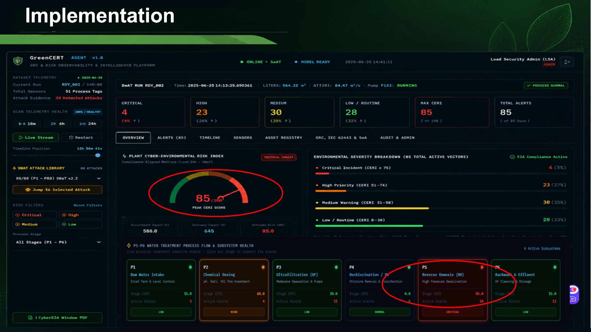

# 🌿 GreenCERT – AECERF Framework

### AI-Enhanced Cyber-Environmental Risk Framework

**Graduation Project | Digilians – 9-Month Professional Diploma | Cybersecurity Track**

---

## 📌 Project Overview

GreenCERT is a cybersecurity project focused on identifying and analyzing the environmental consequences of cyber incidents affecting Operational Technology (OT) and Industrial Control Systems (ICS).

The project introduces the AECERF framework, translating cyber alerts and industrial telemetry into physical and environmental risk insights.

## 🎯 Problem Statement

Traditional cybersecurity monitoring tools focus primarily on technical security alerts without adequately considering their potential environmental consequences.

GreenCERT aims to address three major gaps:

- **Visibility Gap:** Limited environmental context in cyber alerts.
- **Intelligence Gap:** Lack of consequence modeling.
- **Decision Gap:** Limited automated reasoning for incident response.

## 💡 Proposed Solution

GreenCERT introduces a cyber-environmental risk assessment approach based on:

1. Cyber Alert Ingestion.
2. Industrial Process Impact Analysis.
3. Cyber-Environmental Risk Index (CERI).
4. Human-in-the-Loop Response Guidance.

## 🏗️ System Architecture

The proposed architecture consists of three main stages:

### 1. Input
- Raw OT/ICS telemetry.
- Existing security tool exports.
- Industrial sensor readings.

### 2. Analysis
- Process-impact inference.
- Cyber-Environmental Risk Index (CERI).
- Risk normalization and assessment rules.

### 3. Decision
- Recommended containment guidance.
- Human approval and intervention.
- Streamlit-based dashboard interface.

## 🧪 Datasets & Validation

The prototype uses industrial cybersecurity datasets:

- SWaT Dataset.
- HAI Dataset.

These datasets support testing and evaluating the proposed framework.

## 🛠️ Tools & Technologies

- Python
- Streamlit
- SWaT
- HAI
- Syslog
- Docker (Planned)
- Kubernetes (Planned)
- Raspberry Pi Edge (Planned)

## 📊 Key Deliverables

- Prototype monitoring dashboard.
- OT/ICS telemetry visualization.
- Cyber-Environmental Risk Index (CERI) engine and rules.
- Incident analysis and response guidance.

**Project status:** Prototype MVP – Partial implementation.

## 👥 Project Team

- Abdullah Mosaad Abdulfattah
- Rana Mahmoud ElZayat
- Mohamed Raafat Sayed
- Faten Magdy Ibrahim
- Mohamed ElSayed Dowidar
- Esraa Naser Hanafi

**Supervisor:** Eng. Ahmed Abo Elkassem

**Track Leader:** Dr. Rabab Nabay

## 👩‍💻 My Role

Project team member – GreenCERT Graduation Project.

My specific contributions and responsibilities will be documented here as the project work is finalized.

## 🚀 Future Roadmap

- Phase 0: Prototype MVP.
- Phase 1: System Integration.
- Phase 2: Edge Hardware Deployment.
- Phase 3: Cloud Scaling.

---

*GreenCERT – From Cyber Alert to Environmental Consequence.*

**Digilians × NTI | Graduation Project – Cybersecurity Track**
